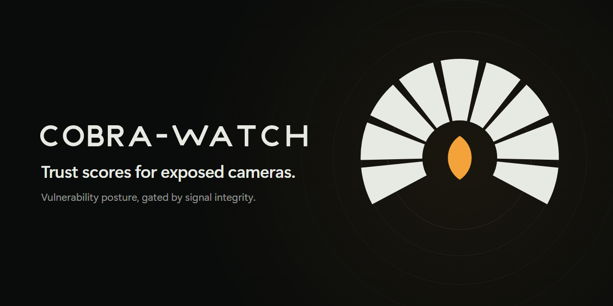
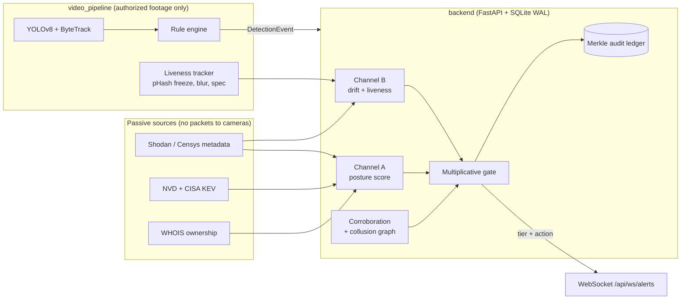

<p align="center">
  
</p>

# COBRA-WATCH

**A camera can be secure and still lie.** COBRA-WATCH is a camera-OSINT trust-scoring platform. It scores internet-exposed surveillance cameras on two independent channels: how vulnerable the device is, and whether its signal is still authentic. A multiplicative gate joins them, so a camera with a spotless vulnerability record but a frozen, looped or swapped feed cannot score as trustworthy.

The scoring method is **IG-DCTF** (Integrity-Gated Dual-Channel Trust Fusion). A journal manuscript describing it is in [`paper/`](paper/).

> **Status.** The scoring engine, API, evaluation harness and paper are working and tested. The previous dashboard was removed and the new web app is specified in [`FRONTEND_SPEC.md`](FRONTEND_SPEC.md) but not built yet. Until then, the backend is fully usable through its interactive API docs at `http://localhost:8000/docs`.

---

## The idea

Vulnerability-only trust models look at a camera's CVEs, authentication, owner and patch age. That misses an attack that needs no vulnerability at all: swap the camera for a decoy that presents the same banner, or loop a recording. A CVE-only model scores that device 100.

| Channel | Question it answers | Signals |
|---|---|---|
| **A: posture** | How exposed is the device? | NVD and CISA KEV CVEs by category, authentication, owner type, firmware patch age, spatial-temporal corroboration |
| **B: integrity** | Is the feed still the real camera? | **Tier 1** passive banner drift (product, server, firmware, open ports, resolution, codec). **Tier 2** frame liveness (frozen-frame run, blur and exposure drift, declared-spec mismatch) |

```
s        = (1 - Drift) * L                      signal integrity, 0..1
G(s)     = 1                                     if s >= 0.85
         = 0.3 + 0.7 (s - 0.50) / (0.85 - 0.50)  if 0.50 <= s < 0.85
         = 0.3, and the score is capped at 30    if s < 0.50   (gate trips)
T_final  = T_cve * G(s)
```

Tiers: `high` 80 and above, `medium` 50 to 79, `low` below 50. The positive class in every evaluation is **fabricated** (an alert from an untrustworthy device or feed).

## Verified results

Every number below comes from [`paper/results.md`](paper/results.md), generated by `paper/scripts/compute_results.py`. Intervals are 95% Wilson.

| Model | Accuracy | Recall | F1 | False positives |
|---|---|---|---|---|
| Weighted average | 0.792 | 0.603 | 0.753 | 0 |
| Advanced (CVE only) | 0.833 | 0.683 | 0.811 | 0 |
| Bayesian log-odds | 0.842 | 0.746 | 0.832 | 3 |
| **IG-DCTF** | **0.975** | **0.952** | **0.976** | **0** |

Exact McNemar test against the CVE-only model: 17 scenarios only IG-DCTF gets right, 0 the other way, p = 1.5e-5. Multiplicative fusion beats additive fusion (3 misses against 10). The gate's decision cost is 4.7 microseconds per event, in-process Python, excluding I/O.

**Read these numbers with their limits.**
- The corpus is **synthetic and hand-authored**: 120 scoreable scenarios (63 fabricated, 57 genuine). Only 30 carry Channel B fields, and the whole gain comes from those 30. On the other 90, IG-DCTF is identical to the CVE-only model.
- The corpus cannot choose the gate thresholds: the F1 surface is flat across all 42 grid points.
- The Tier 1 benchmark has only 13 distinct cases. Tier 2 was evaluated on synthetic frames only.
- A loop of real footage has natural motion, so the frozen-frame rule does not detect it.
- There is no field data yet. Real-world effectiveness is unverified.

The full claim-to-evidence ledger is [`paper/CLAIMS.md`](paper/CLAIMS.md). The older [`eval/eval_report.md`](eval/eval_report.md) predates the Tier 2 weight revision of 2026-10-09 and its numbers differ; `paper/results.md` is canonical.

## Architecture



## Repository layout

| Path | What is in it |
|---|---|
| `backend/` | FastAPI service: routes, trust scoring (`trust_score_service.py`), integrity gate (`signal_integrity_service.py`), corroboration, collusion graph, adaptive decay, audit ledger, 38 test modules |
| `video_pipeline/` | Separate service: YOLOv8 detection, ByteTrack tracking, loitering and perimeter rules, Tier 2 liveness tracker. Reads authorized footage only |
| `eval/` | The 130-scenario labelled corpus, 4-model harness, ablation and threshold-sensitivity scripts |
| `paper/` | IEEE TIFS manuscript, one standalone TikZ file per figure, `results.md`, claim ledger, logs |
| `assets/logo/` | Mark, wordmark and banner, generated by `build_logo.py` |
| `FRONTEND_SPEC.md` | Specification for the new web app |
| `ETHICS_AND_SCOPE_POLICY.md` | What the project will and will not do |

## Quick start

Requires Python 3.12. Docker is optional.

```bash
git clone <this repository> && cd cobra
cp .env.example .env              # add SHODAN_API_KEY, NEWS_API_KEY, GROQ_API_KEY as needed
pip install -r backend/requirements.txt
python backend/main.py            # API on http://localhost:8000, docs at /docs
```

The API starts without any keys. Shodan refresh, news and the AI risk brief need their keys; everything else works from the cached database.

```bash
docker compose up --build         # backend :8000, frontend :3000, video pipeline
```

The compose file expects a `frontend/` directory, which does not exist until the web app is scaffolded from [`FRONTEND_SPEC.md`](FRONTEND_SPEC.md). Start the backend alone with `docker compose up --build backend`.

### Configuration

| Variable | Purpose |
|---|---|
| `SHODAN_API_KEY` | Metadata refresh for the eight supported cities |
| `NEWS_API_KEY` | City news feed |
| `GROQ_API_KEY` | AI risk brief and natural-language query |
| `DETECTION_API_KEY` | Protects `POST /api/detection-event` and verdicts with `X-API-Key`. Empty disables auth (local development only) |
| `CORS_ORIGINS` | Allowed browser origins, default `http://localhost:3000,http://127.0.0.1:3000` |
| `DATABASE_PATH` | SQLite file, default `data/surveillancewatch.db` |

## API

Interactive reference at `/docs`. The main routes:

| Route | Purpose |
|---|---|
| `GET /api/devices?city=` | GeoJSON of cached devices with static-posture trust score, tier and CVEs |
| `GET /api/devices/{id}/trust-score` | On-demand score with every factor |
| `GET /api/integrity/{id}`, `GET /api/integrity/stats` | Channel B state: drift, liveness, gate status |
| `POST /api/detection-event` | Ingest a detection; returns the scored alert (idempotency key, 60 s freshness window, per-camera rate limit) |
| `GET /api/alerts`, `POST /api/alerts/{id}/verdict` | Alert history and operator verdicts |
| `WS /api/ws/alerts` | Live `ALERT` and `INTEGRITY_GATE_TRIPPED` messages |
| `GET /api/audit/ledger`, `/verify`, `/chain-proof`, `/anchor` | Merkle audit ledger and proofs |
| `GET /api/analytics/*`, `/api/stats`, `/api/heatmap` | Fleet, alert and score-comparison analytics |
| `GET /api/config/thresholds` | Live tier and gate thresholds |
| `POST /api/scenarios/run`, `/api/simulate/*` | Demo traffic and attack simulators. Alerts they create are labelled `demo: true` |
| `POST /api/brief/stream`, `POST /api/nl-query` | AI risk brief (SSE) and natural-language device query |

Read routes are open on purpose: the point of the project is public transparency about exposed infrastructure. Writes are authenticated, rate-limited and replay-protected.

## Tests and evaluation

```bash
pytest backend/tests video_pipeline/tests eval/test_eval_harness.py     # 431 passed on 2026-10-12
python eval/run_eval.py --verbose                                        # 4-model comparison
python paper/scripts/compute_results.py                                  # regenerate paper/results.md
```

Some backend tests write to the database named by `DATABASE_PATH`. Point it at a copy before running them against data you care about.

## Ethics and scope

Passive only. COBRA-WATCH does not scan, probe, log in to, exploit or fetch video from any third-party device. It uses metadata that public scanners have already collected, public vulnerability catalogs, ownership records, and pre-authorized or synthetic footage. The video pipeline refuses any source that is not registered as authorized footage. No faces, plates or personal identity are processed.

Aggregated exposure maps are dual-use. Mitigations are authenticated writes, rate limits, a tamper-evident audit ledger, and a commitment to report critical findings to CERT-In and the city administration before publishing. See [`ETHICS_AND_SCOPE_POLICY.md`](ETHICS_AND_SCOPE_POLICY.md).

Known gap: `backend/services/heartbeat_service.py` (`/api/heartbeat/*`) opens TCP connections to device addresses. It is outside the scoring path, but it is an active check, and it is tracked in [`paper/CLAIMS.md`](paper/CLAIMS.md) as claim C15.

## Documentation

| Document | Contents |
|---|---|
| [`paper/`](paper/README.md) | Manuscript, figures, results, claim ledger, Q1 plan, dataset plan |
| [`FRONTEND_SPEC.md`](FRONTEND_SPEC.md) | Design system, pages, motion and 3D architecture, data contracts |
| [`CLAUDE.md`](CLAUDE.md) | Working rules and maintenance protocol for agents |
| [`COBRA_WATCH_BIBLE.md`](COBRA_WATCH_BIBLE.md) | Long-form project reference |
| [`RESEARCH_NOVELTY.md`](RESEARCH_NOVELTY.md), [`FUTURE_SCOPE.md`](FUTURE_SCOPE.md) | Novelty analysis and roadmap |

## License

The repository states MIT, but no `LICENSE` file has been added yet.
